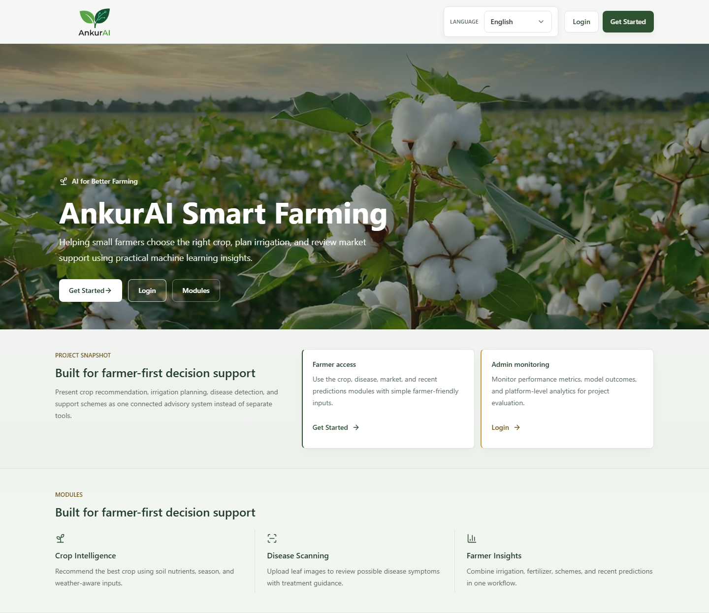
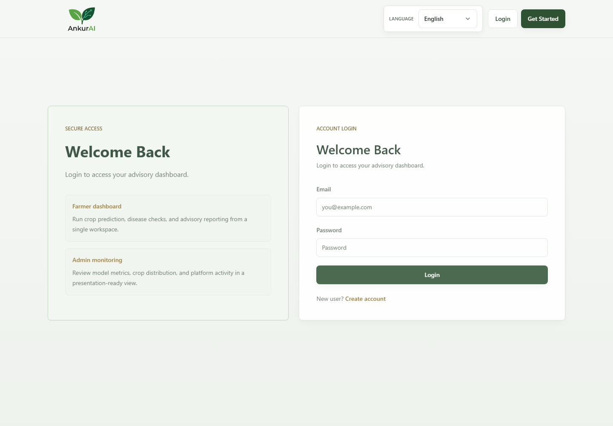
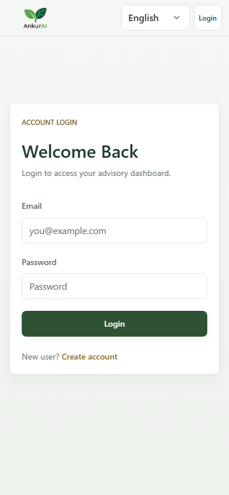
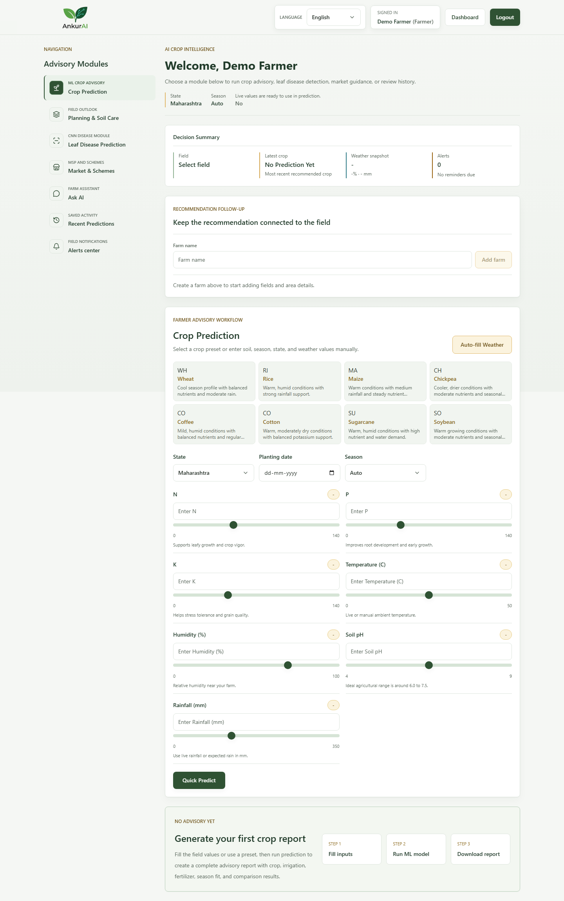
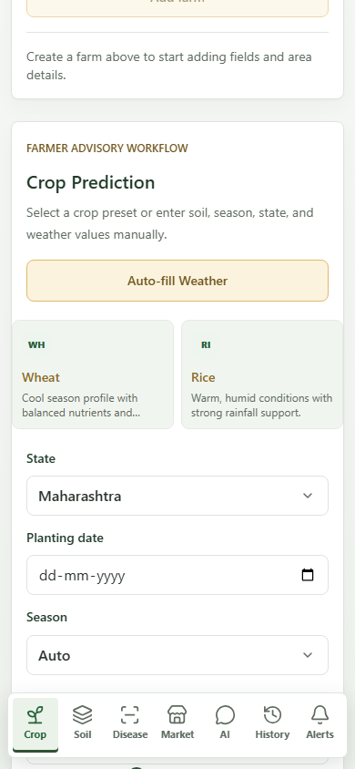
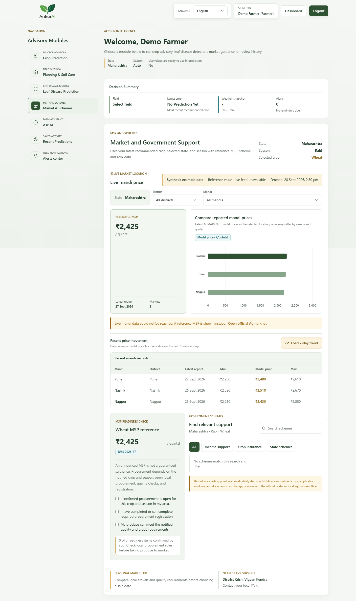
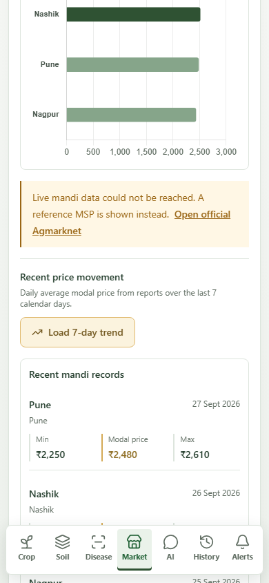

# AnkurAI Smart Crop Advisory System

AnkurAI is a full-stack smart farming assistant for crop recommendation, irrigation planning, pest-outbreak forecasting, leaf disease detection, market support, and farmer-friendly advisory reports.

The project combines a Flask API, React dashboard, SQLite persistence, scikit-learn models, TensorFlow disease detection, and optional live integrations for weather, mandi prices, and AI-assisted farmer guidance.

## Table of Contents

- [Features](#features)
- [Tech Stack](#tech-stack)
- [System Architecture](#system-architecture)
- [Project Structure](#project-structure)
- [Getting Started](#getting-started)
- [Environment Variables](#environment-variables)
- [Model and Dataset Notes](#model-and-dataset-notes)
- [Model Training](#model-training)
- [API Overview](#api-overview)
- [Database and Backups](#database-and-backups)
- [Feature Previews](#feature-previews)
- [Progressive Web App](#progressive-web-app)
- [Deployment](#deployment)
- [Mobile App](#mobile-app)
- [Analytics Dashboard](#analytics-dashboard)
- [Testing](#testing)
- [Troubleshooting](#troubleshooting)
- [Roadmap](#roadmap)
- [Contributing](#contributing)
- [License](#license)

## Features

- Crop recommendation using a Random Forest classifier.
- Irrigation requirement prediction using a Random Forest regressor.
- Weekly pest-outbreak forecasting model trained from tabular field, weather, trap, and pest-history data, surfaced in the Planning & Soil Care workflow.
- Leaf disease detection using MobileNetV2-based CNN artifacts when available.
- Farmer advisory reports with fertilizer, season, irrigation, pest-risk, and reasoning cards.
- Season- and state-aware crop comparison that combines model candidates with rule-based climate, nutrient, season, and regional suitability scores.
- Production outlook with yield planning ranges, suitability constraints, and weather-related risk drivers. These are transparent heuristic estimates, not a trained yield forecast.
- Multi-year soil-restoration guidance covering soil-test priorities, crop rotation, cover crops, residue, compost, and locally validated amendments.
- Field-specific regenerative soil calendar with seasonal task dates, progress status and notes, plus saved soil-test and practice histories.
- Carbon documentation-readiness checklist for field area, baseline and repeat soil measurements, practice logs, and evidence references. It does not estimate credits or carbon sequestration.
- Farm and field workspace with per-farm reminders, recommendation follow-through, intervention records, and farmer-reported outcomes.
- Outcome rationale that compares recorded intervention results with comparable cases and indicates evidence strength when enough records exist.
- Prediction history with side-by-side comparison of saved crop, irrigation, and input values.
- Farmer alerts for due reminders, saved local reminders, and farm follow-up tasks.
- JWT authentication with farmer and admin roles.
- Farmer dashboard for crop prediction, advisory planning, disease detection, market insights, AI chat, farm follow-up, and browser print/PDF.
- Downloadable multi-page farm reports in PDF and field soil-plan/evidence logs in CSV.
- Mobile-first dashboard with bottom navigation, touch-sized controls, swipeable crop presets, and layouts that adapt for phone, tablet, and desktop screens.
- Phone camera capture and photo-library upload for leaf checks, with image preview, file validation, and photo-quality feedback.
- Admin dashboard for platform and model metrics, model artifacts, feature importance, recent activity, and aggregate usage analytics. Usage counts currently cover saved crop and irrigation predictions only, not disease scans, market visits, or AI chats.
- Market support using MSP reference data, KVK contacts, seasonal tips, and optional live Agmarknet mandi prices.
- Optional Groq-powered Ask AI assistant for follow-up farming questions, with answer rating controls.
- In-app translation issue reporting for Hindi and Marathi. An admin review API/component exists, but the review interface is not currently connected to the admin dashboard.
- Browser geolocation-based current weather autofill through Open-Meteo (temperature, humidity, and rainfall; browser permission required).
- Installable React Progressive Web App with offline cached workspace snapshots and queued soil-task edits; new predictions and live integrations still require connectivity.
- Separate Streamlit analytics dashboard.
- English, Hindi, and Marathi UI language support.

## Tech Stack

| Layer | Technology |
| --- | --- |
| Frontend | React 18, React Router, Axios, Tailwind CSS, Lucide React, React Markdown, remark-gfm |
| Backend | Python, Flask, Flask-CORS |
| Authentication | Flask-JWT-Extended, bcrypt |
| Database | SQLite |
| Visualization | Chart.js, react-chartjs-2 |
| Crop, irrigation, and pest ML | scikit-learn, pandas, NumPy, joblib; Random Forest pipelines |
| Disease Detection | TensorFlow/Keras, MobileNetV2, Pillow |
| External integrations | Groq API (optional AI), Open-Meteo (weather), data.gov.in/Agmarknet (optional mandi data) |
| PWA and offline storage | Web App Manifest, Service Worker, browser IndexedDB and localStorage |
| Reports and exports | html2canvas, jsPDF, browser print, CSV export |
| Analytics dashboard | Streamlit, Matplotlib |
| Testing | pytest, React Scripts/Jest, Playwright |

## System Architecture

```text
React PWA
   |
   | Axios + JWT
   v
Flask REST API
   |
   |-- Auth, crop, irrigation, pest outbreak, disease, advisory, market, AI, system routes
   |
   v
SQLite database + ML artifacts
   |
   |-- users and prediction logs
   |-- Random Forest crop and irrigation models
   |-- Random Forest pest-outbreak model
   |-- TensorFlow disease model and class labels
   |-- metrics JSON and feature-importance CSV files
```

## Project Structure

```text
smart-crop-advisory-system/
|-- backend/
|   |-- app.py
|   |-- config.py
|   |-- requirements.txt
|   |-- database/             # SQLite schema, migrations, user and prediction persistence
|   |-- leaf_disease/         # image preprocessing, inference, upload route, training entry point
|   |-- routes/               # auth, prediction, advisory, farm, market, AI, admin APIs
|   |-- services/             # prediction and advisory domain logic, external integrations
|   `-- utils/                # authentication, validation, preprocessing, logging
|-- frontend/
|   |-- public/
|   |-- src/
|   |   |-- pages/            # landing, login, signup, farmer and admin views
|   |   |-- components/       # advisory, farm, disease, market and planning modules
|   |   `-- i18n/             # English, Hindi and Marathi UI strings
|   `-- package.json
|-- ml/
|   |-- crop_data.csv
|   |-- data/                # supply pest_outbreak_training.csv locally; data is gitignored
|   |-- train_pipeline.py
|   |-- train_disease_cnn.py
|   `-- models/
|-- dashboard/
|   |-- dashboard.py
|   `-- requirements.txt
|-- docs/screenshots/
`-- README.md
```

Generated folders such as `venv/`, `.venv/`, `node_modules/`, `build/`, `tmp/`, database files, and local `.env` files are ignored by Git.

## Getting Started

### Prerequisites

- Python 3.10 or newer
- Node.js 18 or newer
- npm
- Git
- Optional: TensorFlow-compatible environment for CNN training
- Optional: data.gov.in API key for live mandi prices
- Optional: Groq API key for Ask AI

### 1. Clone the Repository

```bash
git clone <repository-url>
cd smart-crop-advisory-system
```

### 2. Start the Backend

Windows PowerShell:

```powershell
cd backend
python -m venv venv
.\venv\Scripts\Activate.ps1
python -m pip install --upgrade pip
python -m pip install -r requirements.txt
python app.py
```

macOS/Linux:

```bash
cd backend
python3 -m venv venv
source venv/bin/activate
python -m pip install --upgrade pip
python -m pip install -r requirements.txt
python app.py
```

Backend health check:

```text
http://localhost:5000/api/health
```

### 3. Start the Frontend

Open a second terminal:

```bash
cd frontend
npm install
npm start
```

Frontend URL:

```text
http://localhost:3000
```

The React development server proxies `/api` requests to `http://localhost:5000`.

Before starting Flask, make sure the crop classifier, irrigation regressor, and pest-outbreak classifier versioned `.pkl` artifacts exist under `ml/models/`. The backend loads these models during startup. Git-ignored model files are not included in a fresh clone, and the pest training CSV at `ml/data/pest_outbreak_training.csv` is also not included. See [Model and Dataset Notes](#model-and-dataset-notes) and [Model Training](#model-training) to provision them. Leaf-disease weights are optional for startup; the public disease endpoint returns a model-unavailable response until its model and labels are present.

## Environment Variables

Create `backend/.env` for local configuration:

```env
APP_ENV=development
FLASK_DEBUG=true
FLASK_HOST=0.0.0.0
FLASK_PORT=5000
CORS_ORIGINS=http://localhost:3000
LOG_LEVEL=INFO
DB_PATH=database/predictions.db
ML_DIR=../ml
JWT_SECRET_KEY=change-this-before-production
CROP_CONFIDENCE_THRESHOLD=0.80

GROQ_API_KEY=
GROQ_MODEL=openai/gpt-oss-120b
GROQ_TIMEOUT_SECONDS=25

DATA_GOV_API_KEY=
MANDI_API_TIMEOUT_SECONDS=12
MANDI_CACHE_TTL_SECONDS=1800

INTERVENTION_REMINDER_HOURS=24
FOLLOW_UP_REMINDER_HOURS=72
OUTCOME_MIN_EVIDENCE_CASES=3
```

Create `frontend/.env` only when the API is hosted somewhere other than the local proxy:

```env
REACT_APP_API_BASE_URL=
```

Do not commit `.env` files or real API keys.

`CROP_CONFIDENCE_THRESHOLD` controls the low-confidence warning for crop predictions. Farm reminder timing and the minimum outcome sample size used for evidence strength can be adjusted with the three intervention settings. The backend reads `DB_PATH` and `ML_DIR` as paths; relative values are resolved by the process working directory, so absolute paths are recommended for custom deployments.

### Backend Variable Reference

| Variable | Default | Purpose |
| --- | --- | --- |
| `APP_ENV` | `development` | Environment mode; development adds local/LAN frontend origins to CORS. |
| `FLASK_DEBUG` | `true` | Flask debug mode; disable outside local development. |
| `FLASK_HOST` / `FLASK_PORT` | `0.0.0.0` / `5000` | Backend bind address and port. |
| `CORS_ORIGINS` | `*` | Comma-separated allowed browser origins. In production, set the exact frontend origin. |
| `LOG_LEVEL` | `INFO` | Application log level. |
| `DB_PATH` | `backend/database/predictions.db` | SQLite file location. |
| `ML_DIR` | `<project>/ml` | Root directory searched for trained artifacts. |
| `JWT_SECRET_KEY` | `change-me-in-production` | Secret used to sign access tokens; set a unique secret before deployment. |
| `CROP_CONFIDENCE_THRESHOLD` | `0.80` | Crop prediction confidence warning threshold. |
| `GROQ_API_KEY` | empty | Enables the optional Groq assistant. |
| `GROQ_MODEL` | `openai/gpt-oss-120b` | Model name sent to the Groq API. |
| `GROQ_TIMEOUT_SECONDS` | `25` | Groq request timeout. |
| `DATA_GOV_API_KEY` | empty | Enables live Agmarknet data; `MANDI_API_KEY` is accepted as a fallback. |
| `MANDI_API_URL` | data.gov.in Agmarknet resource | Agmarknet API resource URL. |
| `MANDI_API_TIMEOUT_SECONDS` | `12` | Live mandi request timeout. |
| `MANDI_CACHE_TTL_SECONDS` | `1800` | In-memory live mandi response cache duration. |
| `INTERVENTION_REMINDER_HOURS` | `24` | Delay before an unacknowledged recommendation reminder is due. |
| `FOLLOW_UP_REMINDER_HOURS` | `72` | Delay before an applied-action follow-up is due. |
| `OUTCOME_MIN_EVIDENCE_CASES` | `3` | Minimum recorded outcomes per group for descriptive evidence tiers. |
| `LEAF_DISEASE_CONFIDENCE_THRESHOLD` | `0.40` | Public MobileNetV2 endpoint uncertainty threshold. |
| `LEAF_DISEASE_MODEL_PATH` / `LEAF_DISEASE_LABELS_PATH` | `ml/models/leaf_disease_mobilenetv2.keras` / `ml/models/labels.json` | Override public disease model and label paths. |
| `LEAF_DISEASE_MODEL_HAS_PREPROCESSING` | `1` | Set to `0` only when the selected model expects request-time MobileNetV2 preprocessing. |
| `DISEASE_MODEL_PATH` / `DISEASE_LABELS_PATH` | `ml/models/preliminary_unified_v4/agrointel_unified_mobilenetv2_v4.keras` / `class_names.json` | Override the separate authenticated disease-analysis model and labels. |
| `DISEASE_CONFIDENCE_THRESHOLD` | `0.80` | Confidence threshold for the authenticated disease-analysis service. |
| `FLASK_SKIP_STARTUP_MODEL_WARMUP` | unset | Set to `1` to skip optional TensorFlow disease-model warmup at startup. |

`DB_PATH` and relative overrides for model files are interpreted relative to the backend process working directory. The default database and `ML_DIR` paths are constructed from the project layout. Frontend `REACT_APP_API_BASE_URL` defaults to the same origin; set it to the deployed API base URL before running `npm run build` when frontend and API use different origins. Never put server secrets in frontend environment variables: React build variables are included in browser assets.

## Model and Dataset Notes

| Model/input | Data available in this repository | Supported labels or fields | Notes |
| --- | --- | --- | --- |
| Crop recommendation and irrigation | `ml/crop_data.csv` (800 generated rows) | 7 soil/weather inputs; rice, maize, chickpea, coffee, wheat, cotton, sugarcane, soybean | The dataset is generated by `ml/generate_dataset.py` from hand-authored ranges. Irrigation targets are generated by a simple formula, so metrics describe this synthetic data, not independent farm trials. |
| Public leaf disease detector | MobileNetV2 weights, labels, report, classification report, confusion matrix, and history under `ml/models/` | 15 PlantVillage labels spanning pepper, potato, and tomato | The checked-in report gives 88.71% validation accuracy and 0.8711 macro F1. Performance on field photos, other crops, and other devices may differ. |
| Pest outbreak | Metrics and feature-importance report are present locally; training CSV and versioned model weights are not tracked | Rice, wheat, maize, cotton, soybean; stem borer, aphid, fall armyworm, whitefly | The README's 20,000-row dataset summary describes the local training data, which must be supplied separately at `ml/data/pest_outbreak_training.csv` to reproduce training. |

Versioned Random Forest `.pkl` files and the pest dataset directory are excluded by `.gitignore`; check artifact availability before starting the backend on a fresh clone. Keep the model files from a trusted training run and install matching scikit-learn/joblib versions when moving artifacts between environments. The pest metrics report is a recorded run summary; without its dataset and weights it is not independently reproducible from the tracked repository alone.

## Model Training

The repository uses `ml/train_pipeline.py` for tabular Random Forest training. It writes:

- A versioned `.pkl` model
- A metrics JSON file
- A feature-importance CSV file

### Crop and Irrigation Models

Train from `ml/crop_data.csv` or your own compatible CSV:

```powershell
python .\ml\train_pipeline.py `
  --csv-path .\ml\crop_data.csv `
  --classification-target label `
  --regression-target irrigation_requirement `
  --test-size 0.2 `
  --cv-folds 5 `
  --n-estimators 500 `
  --random-state 42 `
  --output-dir .\ml\models
```

### Pest-Outbreak Forecasting Model

The pest model is trained from weekly tabular records, not leaf images. One row represents one field, crop, pest, and observation week.

Required dataset path:

```text
ml/data/pest_outbreak_training.csv
```

Core columns:

```text
crop_rice,crop_wheat,crop_maize,crop_cotton,crop_soybean,
pest_stem_borer,pest_aphid,pest_fall_armyworm,pest_whitefly,
month,days_after_sowing,temperature_c,humidity_pct,rainfall_7d_mm,
rainfall_14d_mm,wind_speed_kmh,soil_moisture_pct,trap_count_7d,
previous_pest_count_7d,outbreak_next_7d
```

Current local dataset summary:

- 20,000 weekly records
- 5 crops and 4 pest classes
- 1,000 rows per crop-pest combination
- 4 seasons: 2023, 2024, 2025, 2026
- 10 farm/location IDs
- Both outbreak and non-outbreak labels

Training command:

```powershell
python .\ml\train_pipeline.py `
  --csv-path .\ml\data\pest_outbreak_training.csv `
  --feature-columns "crop_rice,crop_wheat,crop_maize,crop_cotton,crop_soybean,pest_stem_borer,pest_aphid,pest_fall_armyworm,pest_whitefly,month,days_after_sowing,temperature_c,humidity_pct,rainfall_7d_mm,rainfall_14d_mm,wind_speed_kmh,soil_moisture_pct,trap_count_7d,previous_pest_count_7d" `
  --classification-target outbreak_next_7d `
  --test-size 0.2 `
  --cv-folds 5 `
  --n-estimators 500 `
  --random-state 42 `
  --output-dir .\ml\models\pest_outbreak
```

Generated pest artifacts:

```text
ml/models/pest_outbreak/rf_classifier_outbreak_next_7d_v*.pkl
ml/models/pest_outbreak/rf_classifier_outbreak_next_7d_metrics.json
ml/models/pest_outbreak/rf_classifier_outbreak_next_7d_feature_importance.csv
```

Latest recorded pest metrics:

```json
{
  "cv_accuracy_mean": 0.851125,
  "cv_f1_weighted_mean": 0.8110528244570283,
  "test_accuracy": 0.8555,
  "test_f1_weighted": 0.8234183956408893
}
```

### Leaf Disease Model

The disease detector uses TensorFlow/MobileNetV2 artifacts when present.

Train the leaf disease model:

```powershell
python .\backend\leaf_disease\train_model.py `
  --dataset-dir .\backend\data\PlantVillage `
  --epochs 12 `
  --fine-tune-epochs 8 `
  --batch-size 32
```

Expected artifacts:

```text
ml/models/leaf_disease_mobilenetv2.keras
ml/models/labels.json
ml/models/leaf_disease_training_report.json
```

Restart the backend after training so the disease model is loaded at startup.

The checked-in report for the public MobileNetV2 endpoint records 88.71% validation accuracy and 0.8711 macro F1 across 15 PlantVillage pepper, potato, and tomato classes at 224 x 224 input resolution. These are validation results on that dataset, not a guarantee of accuracy on field photos or other crops. The public endpoint returns up to three ranked labels with treatment guidance; below its default 0.40 confidence threshold it reports uncertainty rather than presenting the top label as a confident diagnosis. Configure that threshold with `LEAF_DISEASE_CONFIDENCE_THRESHOLD`. The authenticated dashboard endpoint is a separate disease-analysis route and uses its own model configuration.

The public image route accepts JPG/JPEG/PNG, limits uploads to 5 MB, allows up to 20 requests per client IP per minute, and returns a service-unavailable response when the model artifact is missing. Its upload field may be named `file` or `image`. The authenticated `/api/disease/detect` route uses the disease service's available analysis path and also accepts an optional crop context.

## API Overview

Most endpoints require an access token sent as `Authorization: Bearer <token>`. Health, signup, login, and `/api/detect-leaf-disease` are public. Farmer routes accept farmer and admin roles; model information and aggregate admin statistics require the admin role. Prediction history is user-scoped for farmers and can be viewed across users by admins.

| Method | Endpoint | Purpose |
| --- | --- | --- |
| GET | `/api/health` | Backend health check |
| POST | `/api/auth/signup` | Register a farmer or admin |
| POST | `/api/auth/login` | Login and receive access token |
| GET | `/api/auth/me` | Fetch current user |
| POST | `/api/predict/crop` | Predict recommended crop |
| POST | `/api/predict/irrigation` | Predict irrigation requirement |
| POST | `/api/predict/pest-outbreak` | Predict next-7-day pest outbreak risk |
| POST | `/api/advisory` | Generate crop advisory report |
| POST | `/api/disease/detect` | Authenticated disease detection route |
| POST | `/api/detect-leaf-disease` | Public MobileNetV2 leaf disease route |
| GET/POST | `/api/farms` | List or create the signed-in user's farms |
| POST | `/api/farms/<farm_id>/fields` | Add a field to a farm |
| PATCH | `/api/farms/<farm_id>/fields/<field_id>` | Record or update field area in hectares |
| GET/POST | `/api/farms/<farm_id>/soil-plan` | Read or save a field-specific multi-year soil plan and seasonal tasks (`field_id` required) |
| PATCH | `/api/soil-plan-tasks/<task_id>` | Update task status and field notes |
| POST | `/api/farms/<farm_id>/soil-tests` | Save a dated soil laboratory result and evidence reference |
| PUT | `/api/soil-tests/<record_id>` | Correct an owned soil laboratory record |
| POST | `/api/farms/<farm_id>/regenerative-practices` | Log a dated field practice and supporting evidence |
| PUT | `/api/regenerative-practices/<record_id>` | Correct an owned practice record |
| GET | `/api/farms/<farm_id>/carbon-readiness?field_id=<field_id>` | View the field's evidence checklist; no credit calculation |
| GET | `/api/farms/<farm_id>/reminders` | List open action and follow-up reminders |
| POST | `/api/interventions/<id>/acknowledge` | Record that a recommended action was applied |
| POST | `/api/interventions/<id>/follow-up` | Get the available follow-up outcome choices |
| POST | `/api/interventions/<id>/outcome` | Record improved, no-change, worsened, or unknown outcome |
| GET | `/api/farms/<farm_id>/rationale` | Summarize evidence from recorded outcomes and comparable cases |
| GET | `/api/market/overview` | MSP, market, KVK, schemes, and seasonal tips |
| POST | `/api/ai/chat` | Ask AI follow-up questions |
| GET | `/api/predictions` | Recent prediction history |
| GET | `/api/model-info` | Admin-only model metrics, feature importance, and artifact metadata |
| GET | `/api/admin/stats` | Admin-only usage statistics |

The advisory response combines model outputs with season/location context and rule-based modules for production outlook, soil restoration, and pest pressure. The crop suitability comparison is a weighted heuristic (climate and nutrients, season, and state context); it is distinct from the Random Forest crop prediction. Production outlook ranges are planning estimates and must not be read as guaranteed yields. Soil amendments and pest responses should be validated against local soil tests and extension guidance.

Farm/field records, soil plans and task progress, soil tests, regenerative practices, recommendation events, interventions, outcomes, users, and prediction logs are stored in SQLite. Farms and fields are scoped to their owner. Repeated matching recommendations are deduplicated within a short window; reminder deadlines default to 24 hours for an unacknowledged recommendation and 72 hours after an action is recorded. Outcome rationale is descriptive evidence from saved records, not a causal estimate.

### Regenerative Soil and Carbon Documentation

In the farmer dashboard's Planning & Soil Care area, select a farm field to save the advisory's multi-year soil plan. The planner creates seasonal reminders for soil tests, crop rotation, microbial-support review, cover/residue planning, practices, and season review. Dates use generic offsets from the selected plan start date (before sowing, 30 days after, and 180 days after); they are reminders, not a locally calibrated crop calendar. Farmers can mark tasks planned, completed, or skipped and attach notes. Updating a plan preserves the status of matching tasks.

The same workspace stores dated laboratory measurements (soil organic carbon is required; pH and NPK are optional), practice dates and area, and farmer-entered references to lab reports, photos, invoices, or field logs. The rotation, cover/residue, and microbial-support notes can be edited per plan year before saving; these remain suggestions to check against current soil tests, crop context, and local agronomy advice. Existing soil test and practice records can be corrected from their history rows. Export CSV downloads the current field's tasks, progress, soil tests, practices, and readiness checklist. Enter actual laboratory values and the units printed on the report; the app does not fabricate measurements, prescribe amendment rates from these records, or verify uploaded evidence.

Carbon readiness is a documentation checklist only: recorded field area, a baseline organic-carbon measurement, a measurement on another date, at least one logged practice, and evidence references for the baseline and a practice. A completed checklist is not carbon-project eligibility, verification, or a credit estimate. Quantification requires a selected recognized methodology, defined baseline and monitoring boundaries/period, suitable measurements, and the applicable independent verification. Do not represent the checklist as tonnes of CO2e or credits.

### Example Crop Prediction Payload

```json
{
  "N": 52,
  "P": 50,
  "K": 52,
  "temperature": 20,
  "humidity": 68,
  "ph": 6.7,
  "rainfall": 140
}
```

Low-confidence crop predictions still return the best crop instead of failing. The response includes `is_low_confidence`, `confidence_threshold`, `confidence_note`, and `top_crops` so the frontend can show a review warning and alternatives.

### Example Pest-Outbreak Payload

```json
{
  "crop": "wheat",
  "month": 9,
  "days_after_sowing": 48,
  "temperature_c": 27,
  "humidity_pct": 78,
  "rainfall_7d_mm": 34,
  "rainfall_14d_mm": 62,
  "wind_speed_kmh": 8,
  "soil_moisture_pct": 42,
  "trap_count_7d": 11,
  "previous_pest_count_7d": 7
}
```

The endpoint returns ranked risk for stem borer, aphid, fall armyworm, and whitefly where supported by the trained model. The frontend uses this in the `Planning & Soil Care` tab after crop prediction.

### Example Advisory Payload

```json
{
  "crop": "wheat",
  "confidence": 0.92,
  "irrigation": 2.4,
  "state": "Maharashtra",
  "season": "Rabi",
  "inputs": {
    "N": 52,
    "P": 50,
    "K": 52,
    "temperature": 20,
    "humidity": 68,
    "ph": 6.7,
    "rainfall": 140
  },
  "top_crops": [
    { "crop": "wheat", "confidence": 0.92 },
    { "crop": "maize", "confidence": 0.05 }
  ]
}
```

### Authentication and Farm API Examples

The public signup endpoint creates farmer or admin accounts. For a local farmer account, register and then log in:

```bash
API_ROOT=http://localhost:5000

curl -X POST "$API_ROOT/api/auth/signup" \
  -H "Content-Type: application/json" \
  -d '{"name":"Demo Farmer","email":"farmer@example.com","password":"change-this-password","role":"farmer"}'

curl -X POST "$API_ROOT/api/auth/login" \
  -H "Content-Type: application/json" \
  -d '{"email":"farmer@example.com","password":"change-this-password"}'
```

Copy `access_token` from the login response and use it as a bearer token. Create a farm, then attach a field to the returned farm ID:

```bash
TOKEN="<access_token>"

curl -X POST "$API_ROOT/api/farms" \
  -H "Authorization: Bearer $TOKEN" \
  -H "Content-Type: application/json" \
  -d '{"name":"North Farm","location":"Pune, Maharashtra","area":2.5}'

curl -X POST "$API_ROOT/api/farms/<farm_id>/fields" \
  -H "Authorization: Bearer $TOKEN" \
  -H "Content-Type: application/json" \
  -d '{"name":"Field A","crop":"wheat","season":"Rabi","planting_date":"2026-10-15"}'
```

Generate a crop advisory with model outputs and the same seven soil/weather inputs. Add `farm_id` and `field_id` to connect the recommendation to the farm and enable follow-up tracking:

```bash
curl -X POST "$API_ROOT/api/advisory" \
  -H "Authorization: Bearer $TOKEN" \
  -H "Content-Type: application/json" \
  -d '{
    "crop":"wheat",
    "confidence":0.92,
    "irrigation":2.4,
    "state":"Maharashtra",
    "season":"Rabi",
    "farm_id":1,
    "field_id":1,
    "inputs":{"N":52,"P":50,"K":52,"temperature":20,"humidity":68,"ph":6.7,"rainfall":140},
    "top_crops":[{"crop":"wheat","confidence":0.92},{"crop":"maize","confidence":0.05}]
  }'
```

The response contains an `advisory` object. In a normal UI workflow, crop and irrigation values come from `/api/predict/crop` and `/api/predict/irrigation`; the sample values above are illustrative. Use a farm ID and field ID owned by the signed-in account.

Example success response (long recommendation arrays shortened here):

```json
{
  "advisory": {
    "crop": "wheat",
    "context": { "season": "Rabi", "state": "Maharashtra" },
    "fertilizer": [
      { "nutrient": "N", "value": 52.0, "target": 50, "status": "adequate", "recommendation": "Maintain with compost or normal basal dose." }
    ],
    "explanation": {
      "summary": "The model selected Wheat with 92.00% confidence.",
      "main_drivers": [],
      "confidence_level": "high"
    },
    "seasonal_advice": { "current_season": "Rabi", "season_fit": true },
    "season_adjusted": { "original_ml_crop": "Wheat", "season_adjusted_crop": "Wheat", "changed_from_ml": false, "ranking": [] },
    "crop_comparison": [],
    "irrigation": { "value": 2.4, "unit": "model-estimated mm", "level": "low to moderate" },
    "production_outlook": { "yield_estimate": { "planning_range_t_ha": [3.0, 4.9], "confidence": "planning estimate" }, "harvest_window": {}, "pest_risk": {}, "limitations": [] },
    "soil_restoration": { "horizon_years": 5, "soil_condition": "maintenance and restoration", "priority_issues": [], "plan": [], "limitations": [] },
    "rationale": { "evidence_level": "tier_0", "evidence_strength": "Insufficient", "evidence": { "intervention_cases": 0, "comparison_cases": 0 } }
  }
}
```

The `rationale` property is included when the request has a valid `farm_id`; remaining advisory sections contain additional details beyond this shortened example.

### Leaf Disease Upload

Send a multipart request with a file field named `file`:

```text
POST /api/detect-leaf-disease
Content-Type: multipart/form-data
file=<leaf-image.jpg>
```

Supported formats: JPG, JPEG, PNG. Maximum size: 5 MB. The public MobileNetV2 endpoint applies a per-client in-memory limit of 20 requests per minute; this limiter is process-local and is not a substitute for a shared production rate limiter.

### Market Overview

```text
GET /api/market/overview?state=Maharashtra&season=Rabi&crop=wheat
```

When `DATA_GOV_API_KEY` is configured, the market response can include recent Agmarknet mandi records from data.gov.in, with a configurable timeout and cache TTL. Without a key, static MSP, scheme, KVK, and seasonal guidance remain available. Treat fallback information as reference guidance, not a live quote.

## Database and Backups

SQLite is initialized automatically when Flask starts. The database contains `users` and `predictions` tables plus `farms`, `fields`, `farm_events`, `interventions`, and `outcomes` for field-level follow-up, along with `soil_plans`, `soil_plan_tasks`, `soil_tests`, and `regenerative_practices` for the soil-planning workspace. Startup migrations add the field-area and nutrient-unit columns when upgrading older databases. The default file is `backend/database/predictions.db`; override it with `DB_PATH`. Prediction history and farm records contain user-entered and potentially identifying information.

For a simple consistent backup, stop the backend first, copy the configured database file to a protected backup location, then restart the backend. For example, from the project root in PowerShell:

```powershell
New-Item -ItemType Directory -Force D:\secure-backups | Out-Null
Copy-Item .\backend\database\predictions.db D:\secure-backups\predictions-backup.db
```

On macOS/Linux:

```bash
cp backend/database/predictions.db /secure/backups/predictions-backup.db
```

If `DB_PATH` points elsewhere, back up that file instead. Verify backups periodically by restoring a copy into a separate test environment. Do not commit production database files or place unencrypted backups in a public web directory.

## Feature Previews

Screenshots are grouped by the feature shown. Crop screens show the input workflow before a prediction is run. Market screenshots use synthetic sample prices for layout demonstration; they are not live mandi quotes.

### Home and Account Access

The public home page introduces the crop, disease, and farmer-support workflows. Sign-in screenshots show the existing account-entry layout at desktop and phone widths.

<p align="center">
  
  
</p>

<p align="center">
  
</p>

### Crop Advisory

The crop workspace combines crop presets, state and season selection, planting date, and soil and weather inputs. The phone view focuses on the responsive input form.

<p align="center">
  
  
</p>

### Market and Government Schemes

The market workspace presents mandi records, price comparison, MSP reference, scheme filters, and KVK support. Example records are synthetic and the capture explicitly shows that the live feed was not queried.

<p align="center">
  
  
</p>

Regenerate these images with `npm run screenshots` from `frontend/`. The capture uses a demo farmer identity and synthetic market responses. Do not publish screenshots containing real farmer or account data.

## Progressive Web App

The frontend includes a web app manifest, app icons, and a service worker and is installable as a PWA in supported browsers. The service worker caches the app shell and static assets, uses network-first navigation with a cached app-shell fallback, and leaves API requests network-only. Signed-in dashboard snapshots, farm/field lists, reminders, and soil-plan records are stored locally in IndexedDB for offline viewing; soil task status and note edits queue locally and sync when connectivity returns. New crop/disease predictions, live weather/mandi data, and AI responses still require connectivity. Farmers can preview and download a Hindi/Marathi-aware PDF report with field details, advisory, soil plan, tasks, tests, and recorded practices; prediction history is explicitly identified as account-wide when included.

Build:

```bash
cd frontend
npm run build
```

Deploy `frontend/build/` behind HTTPS. Configure the server to:

- Serve `index.html` for client-side routes.
- Serve `manifest.json`, icons, and `service-worker.js` from the site root.
- Expose the Flask API through HTTPS or set `REACT_APP_API_BASE_URL` before building.

For mobile LAN testing during development:

```powershell
cd frontend
$env:HOST = "0.0.0.0"
npm start
```

Then open `http://<PC_IPV4_ADDRESS>:3000` on a phone connected to the same network. Full PWA installation requires HTTPS, except for localhost browser exceptions.

## Deployment

Use separate frontend and API deployments or route `/api` from the frontend host to Flask. For a public deployment:

1. Build the React app with the deployed API base URL when the API is not same-origin: set `REACT_APP_API_BASE_URL` in the build environment, then run `npm run build` from `frontend/`. Serve `frontend/build/` from an HTTPS static host with a fallback to `index.html` for client-side routes.
2. Run Flask behind a production WSGI server and HTTPS reverse proxy. `python app.py` is for local development; disable `FLASK_DEBUG`, set the bind address/port for the host, and keep the app process private behind the proxy.
3. Provision the crop classifier, irrigation regressor, and pest classifier `.pkl` files under `ML_DIR` before starting Flask. These are required during import/startup. The pest training CSV must be supplied separately if retraining; model and dataset files are not part of a normal Git checkout.
4. Set a long, unique `JWT_SECRET_KEY`, exact `CORS_ORIGINS`, and production `APP_ENV`. Keep Groq and data.gov.in API keys only in the backend environment. Use HTTPS for the frontend, API, camera/geolocation permissions, and PWA installation.
5. Mount persistent storage for `DB_PATH`; back up the SQLite database and trained artifacts. Confirm that the deployment platform does not discard its writable data volume when replacing the application.
6. Smoke-check `/api/health`, farmer signup/login, prediction endpoints, disease model availability, and browser installation on the deployed HTTPS origin.

**Authentication setup:** `/api/auth/signup` is public and accepts a caller-supplied `role` of either `farmer` or `admin`. Before exposing this app publicly, restrict or change admin account creation at the API/application layer. Hiding admin signup in the UI is not an authorization control. Use a single persistent SQLite deployment for this configuration; the public disease rate limiter and mandi cache are process-local, so multi-worker or multi-instance deployments need shared equivalents.

The backend requirements do not include a production WSGI server. Add and pin the server used by your deployment platform separately; do not run Flask's debug development server as the public production service.

## Mobile App

AnkurAI is delivered to phones as an installable Progressive Web App (PWA), using the same React application and Flask API as the desktop site. It is not a separately packaged native Android APK or iOS App Store app. The mobile dashboard provides a fixed bottom bar for crop advice, planning and soil care, disease checks, market information, AI chat, and prediction history. Crop presets can be browsed horizontally; soil and weather inputs have paired text and range controls; browser camera capture and photo-library selection are available for leaf checks. The app also adapts account and language controls to smaller screens and respects the device's bottom safe area.

To install on a phone:

1. Deploy the frontend and API to HTTPS, with the API reachable at the configured same origin or set `REACT_APP_API_BASE_URL` when building the frontend.
2. Open the deployed frontend in a supported mobile browser and sign in or create an account.
3. On Android browsers that support the web install prompt, tap **Install App** when it appears or choose the browser's install option. The button only appears when the browser makes the install prompt available.
4. On iPhone or iPad, open the site in Safari, use **Share**, then choose **Add to Home Screen**. iOS does not use the in-page Android install prompt.

The service worker is registered only in production builds. On first visit the device needs a network connection to load the app and sign in. Cached pages and static files can help reopen the app shell later, but prediction history, recommendations, camera analysis, weather, market data, and AI chat depend on the live API or external services. Mobile camera capture and geolocation availability depend on browser support and user permission.

## Analytics Dashboard

The Streamlit dashboard reads the latest crop classifier/regressor artifacts and metrics, plots classifier feature importance and a confusion matrix, and summarizes SQLite crop/irrigation prediction history. It requires the corresponding model artifacts and database to be present; it does not currently serve as a pest or disease analytics dashboard.

```powershell
cd dashboard
python -m venv venv
.\venv\Scripts\Activate.ps1
python -m pip install -r requirements.txt
streamlit run dashboard.py
```

## Testing

Focused backend tests cover prediction and advisory behavior, production outlook, pest outbreak, outcome intelligence, and leaf-disease API handling. Run them with:

```powershell
cd backend
.\venv\Scripts\python.exe -m pytest
```

Frontend tests:

```bash
cd frontend
npm test
```

Browser workflow tests use Playwright with deterministic API responses for account creation, sign-in, protected dashboard access, and farmer module navigation. On a new machine, install the browser once and run the suite:

```bash
cd frontend
npx playwright install chromium
npm run test:e2e
```

The browser suite does not require live AI or mandi credentials. Backend behavior remains covered separately by the Flask pytest suite.

## Troubleshooting

- If the backend cannot load crop or irrigation models, confirm `ml/models/` contains the latest `rf_classifier_*_v*.pkl` and `rf_regressor_*_v*.pkl` files.
- If pest forecasting fails, confirm `ml/models/pest_outbreak/` contains `rf_classifier_outbreak_next_7d_v*.pkl` and rerun the pest training command if needed.
- If disease detection fails, confirm TensorFlow is installed and the `.keras` model plus label JSON files exist.
- If the frontend cannot reach Flask, confirm Flask is running on port `5000` and `frontend/package.json` still has the local proxy.
- If Ask AI fails, set `GROQ_API_KEY` in `backend/.env` and restart the backend.
- If mandi prices are not live, set `DATA_GOV_API_KEY`; otherwise the fallback market guidance is expected.
- If geolocation does not work, allow location access in the browser and use HTTPS for production.
- If print/PDF output looks pale, enable background graphics in the browser print dialog.

## Roadmap

- Add stronger validation and provenance metadata for pest threshold labels.
- Add per-class disease precision, recall, confusion matrix, and sample review screens.
- Improve Hindi and Marathi translation quality for production demos.
- Add weather forecast history and mandi price trends.
- Add SHAP or LIME explanations for model interpretability.
- Move from SQLite to PostgreSQL for multi-user deployment.
- Deploy backend, frontend, and dashboard to cloud infrastructure.

## Contributing

1. Fork the repository and create a focused branch from the current default branch.
2. Install the backend and frontend dependencies described above. Keep `.env`, database files, private API keys, and large model/data files out of commits.
3. Run the focused backend tests and build the frontend before opening a pull request.
4. Include a short description of the behavior changed, validation performed, and any required configuration or dataset updates. Add screenshots for visible UI changes when possible.

For model changes, include the training/evaluation procedure, dataset provenance and license, supported labels/features, and metrics. Do not commit raw farmer data or credentials.

## License

No `LICENSE` file is currently included. The project is maintained as an academic project, but that does not by itself grant permission to reuse, redistribute, or modify it. Choose and add a license before publishing the repository for reuse, and check the licenses for datasets, trained model weights, and other assets separately.
